  

  
  
  

### 🏏 Two games, one mindset

I'm a **professional cricketer** (opening bat, right-handed) and a **sports analyst in the making**. I've played state-level cricket with the Tamil Nadu Cricket Association and the Tamil Nadu Premier League (Dindigul Dragons), and I'm still playing in the US, in the **Massachusetts State Cricket League** and the **Charlotte Premier League**.

Off the field I'm doing an **MS in Business Analytics at Suffolk University**, I'm a **2026 MIT Sloan Sports Analytics Conference mentee**, and I build models and tools that turn performance data into decisions. The first time data fixed my own batting (missed deliveries down from 20% to 7%), I knew this was my second game.

### 🎯 Team sheet

  
  

### 🧰 Kit bag

  
  
  
  
  
  
  
  
  

### 📈 Wagon wheel

My GitHub activity, drawn the way a cricket analyst would: every line is a day at the crease, and the ones that reach the rope are my biggest days. It redraws itself every day.

---

Every shot is data. · <a href="https://hemanthkumargopi.vercel.app">hemanthkumargopi.vercel.app</a>

