  <a href="https://hemanthkumargopi.vercel.app">Website</a>&nbsp;&nbsp;·&nbsp;&nbsp;<a href="https://www.linkedin.com/in/hemanthkumargopi">LinkedIn</a>&nbsp;&nbsp;·&nbsp;&nbsp;<a href="mailto:hemanthkumargopi55@gmail.com">Email</a>

I build machine-learning models and data products for sport. I'm also a professional cricketer, so I start from how the game is actually played and work back to the data. Data first proved itself on my own batting: missed deliveries fell from 20% to 7%.

### Selected work

  
  

### Toolkit

**Python** (pandas, NumPy, scikit-learn, matplotlib) · **SQL** · **Tableau** · **Excel** · **JavaScript** · **SAP S/4HANA** · **Google Cloud** · **Claude**

<a href="https://hemanthkumargopi.vercel.app">hemanthkumargopi.vercel.app</a>

